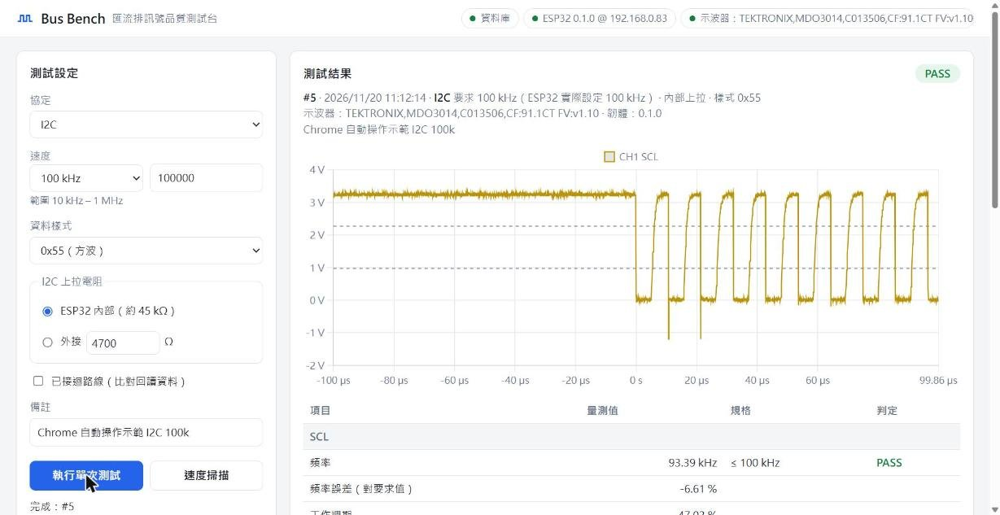
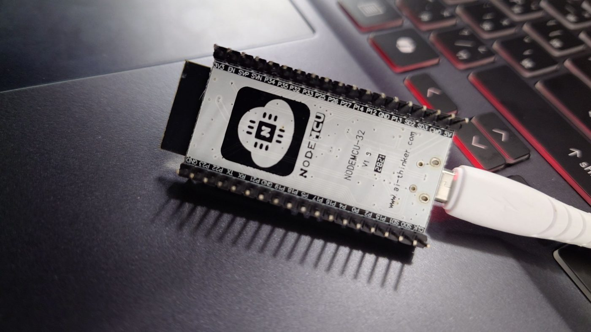
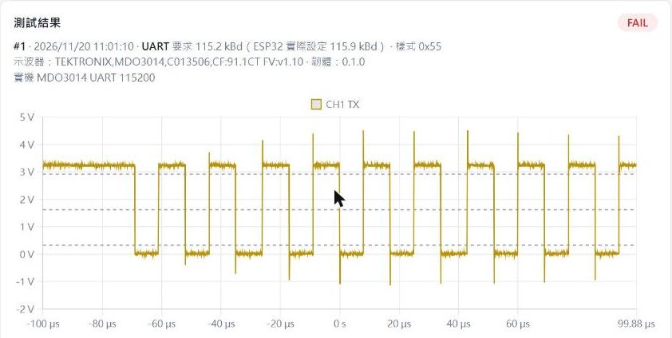
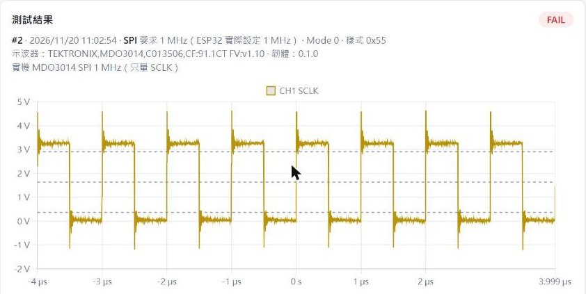
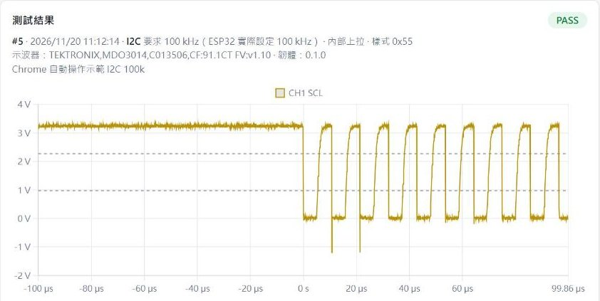
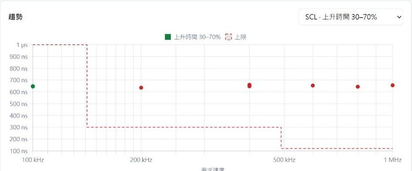
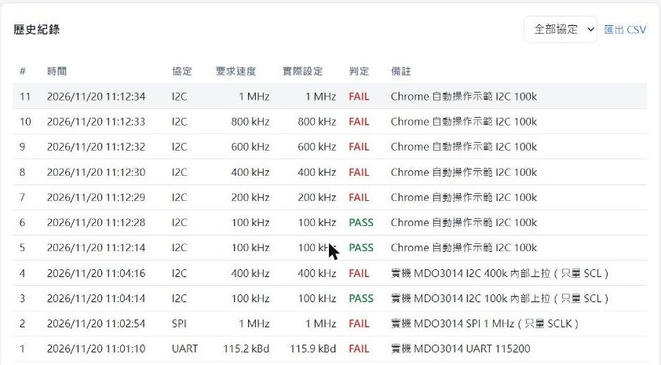
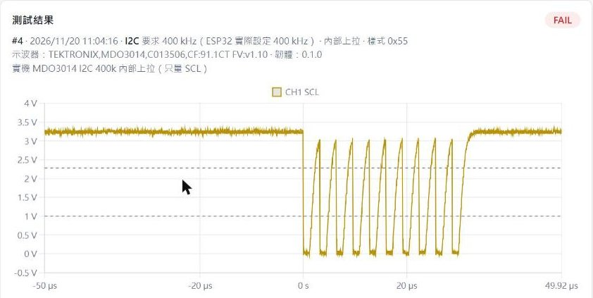
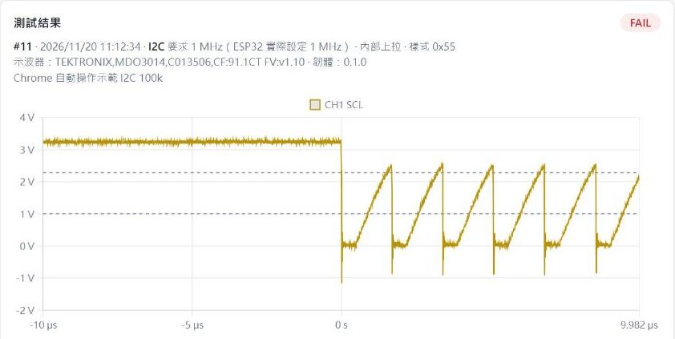

# Bus Bench：ESP32 匯流排訊號品質測試台

> **一句話介紹**：用 ESP32 送出 UART / SPI / I2C 訊號，Python 後端透過網路控制 Tektronix 示波器擷取波形，
> 自動計算頻率、上升時間、過衝等參數，依規格判定 PASS / FAIL，結果存進資料庫並在網頁儀表板顯示。



---

## 1. 這個專案在解決什麼問題

- 硬體驗證常要回答三個問題：**訊號對不對（頻率）、夠不夠快（上升時間）、乾不乾淨（過衝、準位）**。
- 手動用示波器量：要調設定、看游標、抄數字，慢而且難追溯。
- 這個專案把「送訊號 → 擷取 → 量測 → 判定 → 紀錄」全部自動化：**一次測試約 1.5 秒**，一組 6 個速度的掃描約 6 秒，每筆都記下示波器型號、韌體版本、波形與量測值。
- 量測演算法自己用 numpy 寫，**與示波器型號無關**；示波器內建量測只拿來交叉比對，確認算法正確。

## 2. 系統架構

```
            Wi-Fi（REST API）                    LAN（VISA / SCPI）
 ESP32  ◄─────────────────────  Python 後端  ─────────────────────►  Tektronix MDO3014
 訊號產生器                     （FastAPI）                           示波器
   │  GPIO 17 / 18 / 22 …          │                                     ▲
   └──────────────── 探棒 ─────────┼─────────────────────────────────────┘
                                   ├──► PostgreSQL（Docker）：測試紀錄、量測值、波形
                                   └──► 網頁儀表板 http://127.0.0.1:8000
```

### 2.1 通訊方式與 IP

| 連線 | 實體層 | 協定 | 位址（本機實測） |
|---|---|---|---|
| PC ↔ ESP32 | Wi-Fi（實驗室路由器） | HTTP/1.1 REST，內容是 JSON | `http://192.168.0.83`，port 80（也可用 mDNS：`busbench.local`） |
| PC ↔ 示波器 | 乙太網路（區域網路） | **VXI-11**（LXI 標準，跑在 TCP/IP 上），內容是 **SCPI** 文字指令 | `TCPIP0::192.168.0.20::inst0::INSTR` |
| 瀏覽器 ↔ 後端 | 本機 | HTTP/JSON | `http://127.0.0.1:8000`，只開放本機 |
| 後端 ↔ 資料庫 | 本機 | PostgreSQL 協定 | `127.0.0.1:5432`，只開放本機 |
| ESP32 → 示波器 | 探棒 | 沒有資料連線，示波器只是量 GPIO 的電壓 | — |

**PC ↔ ESP32（REST API）**

- `GET /api/info` 查韌體版本、IP；`GET /api/status` 查執行狀態。
- `POST /api/run` 開始送訊號，例如 `{"protocol":"i2c","speed_hz":100000,"pattern":"0x55"}`；`POST /api/stop` 停止。
- 會改變狀態的 POST 必須帶 Basic Auth 帳密，加上自訂標頭 `X-Requested-With: busbench`，用來擋掉網頁跨站偽造請求（CSRF）。

**PC ↔ 示波器（VXI-11 + SCPI）**

- VXI-11 先連示波器的 port 111（portmapper）取得服務埠，再用那個埠收發指令。
- 指令是純文字，例如設定 `CH1:SCAle 1`、`TRIGger:A:EDGE:SOUrce CH1`，擷取 `ACQuire:STATE ON`，抓波形 `CURVe?`。
- 波形以二進位區塊（IEEE 488.2 格式）傳回，每點 1 byte，再用 `WFMOutpre:YMUlt?`、`XINcr?` 等縮放參數換算成電壓和時間。

**PC 的網路**：Wi-Fi 是 `192.168.0.98`。有線網卡設了 `192.168.0.3`，如果有線網路線還接著，會出現「同網段、兩張網卡」的路由問題（見第 9 節），建議拔掉。

**IP 會變**：ESP32 和示波器的位址是路由器 DHCP 配的或手動設的，換網路就會變。ESP32 開機時序列埠會印 `WiFi up: <IP>`；示波器在 Utility → I/O 查。

### 2.2 軟體元件

| 部分 | 用什麼 |
|---|---|
| VISA | **pyvisa + pyvisa-py**，用純 Python 實作 VXI-11，**沒有用 TekVISA 或 NI-VISA**。這台電腦裝的系統 VISA（`visa32.dll`）在 Python 3.14 下查詢會當掉，所以 `.env` 設 `VISA_BACKEND=@py`；好處是不用裝驅動。未來改用 USB 連示波器，就需要裝 TekVISA 或 NI-VISA。 |
| 後端 | Python 3.14：FastAPI + uvicorn（網頁伺服器）、pydantic-settings（讀 `.env`）、httpx（呼叫 ESP32）、numpy（量測演算法）、psycopg 3 + 連線池（資料庫） |
| 前端 | 純 HTML + JavaScript，沒用框架，由後端直接提供。圖表用 **Chart.js 4.4.4**，從 jsdelivr CDN 載入，所以**電腦要能上網，圖表才顯示得出來** |
| 資料庫 | **PostgreSQL 17**，跑在 Docker（`postgres:17-alpine`）。資料存在 Docker volume `pgdata`，建表 SQL 在 `server/sql/001_init.sql`（欄位說明見第 7 節） |
| 韌體 | Arduino 框架 + PlatformIO（pioarduino 55.03.37）：`WebServer`（HTTP）、mDNS、Wi-Fi 設定存在 NVS |

### 2.3 一次測試的流程

1. 後端呼叫 ESP32 `POST /api/run`，ESP32 開始持續送訊號。
2. 後端依協定與速度設定示波器（時基、觸發），做一次單次擷取（Single）。
3. 抓回原始波形（約 1 萬點），用 Python 計算量測值。
4. 對照規格判定 PASS / FAIL，寫進資料庫，通知 ESP32 停止。

## 3. 硬體與接線

| 項目 | 規格 |
|---|---|
| 開發板 | Ai-Thinker NodeMCU-32（ESP-32S 模組，ESP32-D0WD） |
| 示波器 | Tektronix MDO3014（100 MHz、4 通道），TPP0250 探棒（10X） |
| 連線 | ESP32 走 Wi-Fi；示波器接路由器（LAN），與電腦同網段 |

背面絲印的 `P17`、`P18`… 就是 GPIO 編號。**注意 `TX` 那支是 USB 序列埠（GPIO1），不是測試訊號。**



| 協定 | CH1 探針 | CH2 探針（有第二支探棒時） | 接地夾 |
|---|---|---|---|
| UART | P17（TX） | — | GND |
| SPI | P18（SCLK） | P23（MOSI） | GND |
| I2C | P22（SCL） | P21（SDA） | GND |

探棒設 10X，接地夾**越短越好**（長接地線會造成振鈴，見第 9 節）。

---

## 4. 三種匯流排入門（給沒接觸過的人）

三者都是「晶片之間傳資料」的方式，差別在**有沒有時脈線、用幾條線、能接幾個裝置**。

### 4.1 UART：兩個人約好速度講話

- **兩條線**：TX（送）、RX（收），交叉接。**沒有時脈線**，雙方事先約定速度（**鮑率**，例如 115200 = 每秒 115200 個位元）。
- 平常是高電位（閒置）。每個位元組的格式：**起始位元（0）→ 8 個資料位元（低位元先送）→ 停止位元（1）**。
- 接收端在每個位元的**中間**取樣，所以雙方速度不能差太多（一般要求 ±2% 內）。
- 用途：除錯訊息（printf）、GPS、藍牙 / 4G 模組。
- **本專案送 0x55**（二進位 01010101）：加上起始、停止位元剛好 0、1 交替，變成方波，**頻率 = 鮑率 ÷ 2**，最好量。



### 4.2 SPI：老師打拍子，大家跟著拍子傳

- **四條線**：SCLK（時脈）、MOSI（主→從資料）、MISO（從→主資料）、CS（選擇哪個從端）。
- **主端產生時脈**，資料在時脈邊緣取樣，所以不用約定速度，可以跑很快（數 MHz 到數十 MHz）。
- 可以同時送和收（全雙工）。一個主端接多個從端時，每個從端各一條 CS。
- 有 4 種模式（Mode 0–3），決定時脈閒置是高或低、在哪個邊緣取樣。
- 用途：Flash 記憶體、LCD 顯示器、ADC。
- 輸出是**推挽**（主動拉高也主動拉低），邊緣很快，**容易有過衝、振鈴**，所以要量訊號乾不乾淨。



### 4.3 I2C：兩條線、多個裝置、靠位址點名

- **兩條線**：SCL（時脈）、SDA（資料）。很多裝置共用同兩條線，用 **7 位元位址**區分。
- **開汲極（Open-drain）**：裝置只能把線「拉低」，**拉高靠上拉電阻**。所以上升邊緣是電阻對線上電容充電，**又慢又呈 RC 曲線**。
- 起始條件：SCL 為高時 SDA 從高變低。每個位元組後從端回 ACK（拉低）表示收到。
- 標準速度：100 kHz（Standard）、400 kHz（Fast）、1 MHz（Fast-mode Plus）。
- 用途：溫溼度感測器、EEPROM、RTC 時鐘、觸控 IC。
- **最重要的量測是上升時間**：上拉電阻太大或線太長（電容大）就會太慢，超出規格就會出錯。



### 4.4 一張表比較

| | UART | SPI | I2C |
|---|---|---|---|
| 線數（不含 GND） | 2（TX、RX） | 4（SCLK、MOSI、MISO、CS） | 2（SCL、SDA） |
| 時脈 | 無，雙方約定鮑率 | 主端提供 | 主端提供 |
| 輸出方式 | 推挽 | 推挽 | 開汲極 + 上拉電阻 |
| 裝置數 | 一對一 | 一主多從（每個從端一條 CS） | 多個裝置共用，用位址區分 |
| 典型速度 | 9600 – 921600 Bd | 1 – 數十 MHz | 100k / 400k / 1 MHz |
| 最該量什麼 | 鮑率誤差 | 時脈頻率、工作週期、過衝 | 上升時間 |

---

## 5. 量測參數：量什麼、示波器怎麼設

### 5.1 參數意義

| 參數 | 意義 | 怎麼算（本專案） |
|---|---|---|
| 頻率 / 週期 | 每秒幾個週期 / 一個週期多久 | 相鄰上升緣（50% 位置）的時間差取平均 |
| 鮑率、鮑率誤差 | UART 實際速度、與要求值差幾 % | 由邊緣間隔推出一個位元的時間，鮑率 = 1 ÷ 位元時間 |
| 工作週期（Duty） | 一個週期中高電位佔幾 % | 高電位時間 ÷ 週期；時脈理想值 50% |
| 高 / 低準位 | 穩定的高、低電壓 | 電壓直方圖中出現最多的值（避開過衝的尖峰） |
| 上升 / 下降時間 10–90% | 邊緣從 10% 爬到 90% 要多久 | 一般訊號用這個 |
| 上升 / 下降時間 30–70% | 同上，但用 30% 和 70% | **I2C 規格（UM10204）指定用這個** |
| 過衝 / 下衝 | 邊緣衝過頭的量 | (最大值 − 高準位) ÷ 振幅 × 100% |

> RC 曲線的換算：上升時間 10–90% ≈ 2.197τ，30–70% ≈ 0.847τ（τ = R × C）。單元測試用已知 τ 的合成波形驗證過這兩個公式。

### 5.2 示波器設定（本專案自動完成）

| 設定 | UART | SPI | I2C | 為什麼 |
|---|---|---|---|---|
| 觸發來源 / 邊緣 | TX 下降緣 | SCLK 上升緣（Mode 0/1） | SDA 下降緣（只有一支探棒時改用 SCL） | 每次都從同一個位置開始看，波形才穩定 |
| 觸發準位 | 1.65 V | 1.65 V | 1.65 V | 3.3 V 訊號的一半 |
| 時基（每格） | 約 2 個位元 | 約 1.2 個週期 | 約 2.4 個週期 | 畫面放 10–20 個位元 / 週期，夠算頻率 |
| 垂直 | 1 V/格，0 V 在中心下方 3 格 | 同左 | 同左 | 0 – 3.3 V 和過衝都在畫面內 |
| 擷取 | 單次擷取、1 萬點、DC 耦合 | 同左 | 同左 | |

**三個設定原則**（面試常問）：

1. **觸發**：選一個「每次都會出現在同一位置」的邊緣，準位設在高低電位中間。
2. **時基**：看頻率時畫面放 10–20 個週期；要量上升時間，**取樣間隔必須遠小於上升時間**（邊緣上至少 5 點）。
   取樣間隔 = 畫面總時間 ÷ 點數。例：UART 20 µs/格 × 10 格 ÷ 1 萬點 = **20 ns/點**，量不到幾 ns 的邊緣；SPI 0.8 µs/格 → **0.8 ns/點**，就量得到。
3. **探棒**：10X、接地夾越短越好。示波器頻寬有限（本機 100 MHz），量到的上升時間是「訊號 + 探棒 + 示波器」合起來的結果。

### 5.3 判定規格

| 協定 | 項目 | 規格 | 來源 |
|---|---|---|---|
| UART | 鮑率誤差 | ±2% | 一般建議值 |
| SPI | SCLK 頻率誤差（對 ESP32 實際設定）、工作週期 | ±2%、45–55% | 一般建議值 |
| UART / SPI | 高 / 低準位、過衝 | ≥ 2.4 V、≤ 0.4 V、≤ 20% | 3.3 V LVTTL / 一般建議值 |
| I2C | 上升時間 30–70% | 100k ≤ 1000 ns、400k ≤ 300 ns、1M ≤ 120 ns | UM10204 |
| I2C | 下降時間 70–30% | ≤ 300 / 300 / 120 ns | UM10204 |
| I2C | 高 / 低準位 | ≥ 0.7 × 3.3 V、≤ 0.4 V | UM10204 |

規格可在 `server/limits_override.json` 覆寫。

---

## 6. 操作方式

### 6.1 啟動

1. 啟動資料庫：專案根目錄執行 `docker compose up -d`。
2. 啟動後端：雙擊 `tools\bench\start_server.cmd`（視窗保持開著；關掉視窗＝停止後端）。
3. 瀏覽器開 `http://127.0.0.1:8000`。右上角三個**綠點**代表資料庫、ESP32、示波器都已連上。

`.env` 重點設定（密碼類不列出）：

| 鍵 | 本機設定 | 說明 |
|---|---|---|
| `ESP32_MOCK` | `0` | `1` = 不接 ESP32，用模擬 |
| `ESP32_URL` | `http://192.168.0.83` | ESP32 的 IP（開機時序列埠印出 `WiFi up: <IP>`） |
| `SCOPE_DRIVER` | `tek` | `sim` = 模擬示波器 |
| `SCOPE_RESOURCE` | `TCPIP0::192.168.0.20::inst0::INSTR` | 示波器 VISA 位址 |
| `VISA_BACKEND` | `@py` | 用 pyvisa-py，不必安裝 NI-VISA |
| `SCOPE_CH_PRIMARY` / `SECONDARY` | `CH1` / 空白 | 只有一支探棒時第二個留空 |

### 6.2 單次測試

1. **協定**：選 UART / SPI / I2C（下方「探棒接線」會提示要接哪支腳）。
2. **速度**：選預設值或自訂。
3. **資料樣式**：建議 `0x55（方波）`，最好量。
4. I2C 另外選**上拉電阻**：ESP32 內部（約 45 kΩ）或外接阻值。
5. **備註**：例如「外接 4.7k、短接地彈簧」。
6. 按 **執行單次測試**，約 1.5 秒後顯示：判定（PASS / FAIL）、波形（虛線是 10 / 50 / 90% 門檻）、量測表（量測值、規格、判定）。
   標「示波器內建」的列是示波器自己量的值，用來和 Python 算的值交叉比對。

### 6.3 速度掃描與趨勢

按 **速度掃描**，自動依序跑一組速度（I2C：100k / 200k / 400k / 600k / 800k / 1M）。
「趨勢」圖可選任一量測項目對速度作圖，紅色虛線是規格上限；點資料點可開啟該次測試。



### 6.4 歷史紀錄與匯出

所有測試都在「歷史紀錄」，可依協定篩選、點選重新開啟、**匯出 CSV**（Excel 可直接開，含中文）。



---

## 7. 資料庫結構

三張表：一次測試（`test_run`）對應多筆量測值（`measurement`），以及每個通道一筆波形（`waveform`）。刪除一次測試，它的量測值和波形會一起刪掉。

### 7.1 `test_run`：一次測試一筆

| 欄位 | 意義 | 例：第 3 筆（I2C 100k） |
|---|---|---|
| `id` | 測試編號，就是儀表板上的 #3 | 3 |
| `started_at` / `finished_at` | 開始和結束時間 | 11:04:14 / 11:04:16 |
| `protocol` | 協定：`uart` / `spi` / `i2c` | `i2c` |
| `speed_hz` | **要求**的速度（鮑率或時脈頻率） | 100000 |
| `actual_hz` | ESP32 **實際**設定的速度（除頻後，例如 SPI 要求 30 MHz 實際是 26.67 MHz） | 100000 |
| `params` | 其他設定（JSON）：資料樣式、SPI 模式、上拉電阻種類與阻值、是否接迴路線 | `{"pattern":"0x55","pullup":"internal",…}` |
| `sweep_id` | 同一次速度掃描的測試共用同一個 ID；單次測試是空值 | 空值（#6–#11 共用一個） |
| `scope_idn` / `esp32_fw` | 當次的示波器型號序號、韌體版本，方便追溯 | `TEKTRONIX,MDO3014,…` / `0.1.0` |
| `status` | `running`（進行中）/ `done`（完成）/ `error`（失敗） | `done` |
| `verdict` | 總判定：任何一項 FAIL 就是 FAIL | `PASS` |
| `note` | 備註；測試失敗時存錯誤訊息（例如第 12 筆的 10054） | 實機 MDO3014 I2C 100k… |

### 7.2 `measurement`：一個量測項目一筆（每次測試約 8–13 筆）

| 欄位 | 意義 | 例 |
|---|---|---|
| `run_id` | 屬於哪次測試 | 3 |
| `channel` | 訊號名稱 | `SCL` |
| `name` | 量測項目代號 | `rise_30_70` |
| `value` | 量測值，**一律用國際單位制**（秒、Hz、V、%） | `6.48e-7`（= 648 ns） |
| `unit` | 單位 | `s` |
| `source` | `calc` = Python 算的；`scope` = 示波器內建量測（只用來交叉比對） | `calc` |
| `limit_min` / `limit_max` | 規格上下限；空值代表沒有規格，只供參考 | 空值 / `1e-6` |
| `pass` | 這一項是否合格；空值代表不判定 | `true` |

`name` 有這些：

- **時間和速度**：`frequency`（頻率）、`freq_error_pct`（對實際設定值的誤差 %）、`freq_error_req_pct`（對要求值的誤差 %）、`duty`（工作週期）、`baud_measured` / `baud_error_pct` / `bit_time`（UART 鮑率、誤差、位元時間）。
- **邊緣**：`rise_10_90` / `fall_90_10`（上升 / 下降時間 10–90%）、`rise_30_70` / `fall_70_30`（I2C 用的 30–70%）。
- **電壓**：`vhigh` / `vlow`（高 / 低準位）、`vpp`（峰對峰值）、`overshoot` / `undershoot`（過衝 / 下衝 %）。

### 7.3 `waveform`：原始波形，每次測試每個通道一筆

| 欄位 | 意義 |
|---|---|
| `run_id`、`channel` | 哪次測試、哪個訊號，兩者合起來是主鍵 |
| `source` | 示波器通道，例如 `CH1` |
| `x_zero` | 第一點的時間（秒），以觸發點為 0，所以通常是負的 |
| `x_incr` | 取樣間隔（秒） |
| `y_unit` | 電壓單位，`V` |
| `points` | 電壓陣列（`real[]`，約 1 萬點，每筆約 40 KB） |

第 i 點的時間 = `x_zero + i × x_incr`，電壓 = `points[i]`。存原始波形，是為了日後改了演算法還能重新計算。

### 7.4 查詢範例：I2C 各速度的上升時間（趨勢圖就是這樣查的）

```sql
SELECT r.id, r.speed_hz, r.params->>'pullup' AS pullup,
       m.value * 1e9 AS rise_ns, m.limit_max * 1e9 AS limit_ns, m.pass
FROM test_run r
JOIN measurement m ON m.run_id = r.id
WHERE r.protocol = 'i2c' AND m.channel = 'SCL'
  AND m.name = 'rise_30_70' AND m.source = 'calc'
ORDER BY r.speed_hz, r.id;
```

---

## 8. 實測結果（2026-11-20，MDO3014，單支探棒）

| 測試 | 判定 | 重點數據 |
|---|---|---|
| UART 115200 | FAIL | 鮑率 +0.5 ~ +1.2%（合格）；**過衝約 40%** 超過 20% |
| SPI 1 MHz | FAIL | 頻率 1,000,020 Hz（示波器量 999,968 Hz，差 0.005%）；工作週期 49.99%；**過衝 44%** |
| I2C 100 kHz（內部上拉） | **PASS** | 上升時間 30–70% = 648 ns（≤ 1000 ns） |
| I2C 400 kHz（內部上拉） | FAIL | 上升時間 660 ns（≤ 300 ns）；時脈只到 313 kHz |
| I2C 1 MHz（內部上拉） | FAIL | 上升時間 656 ns（≤ 120 ns）；SCL 只爬到約 2.5 V，時脈只到 584 kHz |

I2C 400 kHz：上升邊緣明顯是 RC 曲線，來不及爬上去。



I2C 1 MHz：還沒爬到高電位就又被拉低，變成鋸齒波。



---

## 9. 發現與心得（面試可講的重點）

1. **量測結果可信**：Python 計算與示波器內建量測交叉比對，SPI 頻率差 0.005%、上升時間差 0.7%（1.93 vs 1.92 ns），I2C 頻率差 < 0.1%。
2. **I2C 上拉電阻決定上升時間，與速度無關**：ESP32 內部上拉約 45 kΩ，量到上升時間固定約 650 ns（τ ≈ 0.77 µs），所以只有 100 kHz 合格。
   而且上升太慢會**拖慢時脈**：ESP32 會等 SCL 真的變高才繼續，400 kHz 實際只跑到 313 kHz。
   解法：外接 2.2 – 4.7 kΩ 上拉電阻（上升時間約可縮短 10 倍）。
3. **過衝約 40% 很可能是探棒造成的**：SPI 以 0.8 ns/點取樣，看到每個邊緣都有振鈴。最常見原因是探棒長接地線的電感，換成短接地彈簧可以驗證。
   → 量測本身也會影響結果，判讀前要先確認量測方法。
4. **ESP32 UART 的位元長度不是均勻的**：115200 時每個位元是 8 µs 或 9 µs 交替（理想 8.68 µs），邊緣都落在整數微秒，代表 UART 時脈是 1 MHz（推測是 REF_TICK）。平均鮑率仍在規格內，但單一位元的長度會比理想值短 8% 或長 4%。
5. **SPI 速度是除頻的結果**：ESP32 SPI 時脈 = 80 MHz ÷ 整數，所以要求 30 MHz 實際是 26.67 MHz；判定以 ESP32 實際設定值為準。
6. **網路除錯**：電腦 Wi-Fi 和有線網卡在同一網段時，Windows 只會選一張網卡送封包，導致示波器 ping 掉一半、連線時通時不通。解法是讓示波器接回同一個網路，或直連線路改用另一個網段。

## 10. 面試可能被問到

- **為什麼不直接用示波器內建量測？**
  自己算可以跨廠牌、跨型號一致，規格與演算法可控、可追溯；內建量測只做交叉比對。
  例如 UART 的週期本身在 17 / 18 µs 間跳動，示波器內建頻率只量第一個週期，Python 取平均，兩者都對但意義不同。
- **I2C 為什麼用 30–70% 而不是 10–90%？**
  I2C 規格 UM10204 就是這樣定義，和輸入端的判斷門檻（30% / 70% VDD）對應。
- **上升時間太慢會怎樣？怎麼改善？**
  可能被誤判成錯的位元、時脈被拖慢。改善：降低上拉電阻、縮短線長（降低電容）、降低速度。
- **怎麼確保量測程式正確？**
  單元測試用已知時間常數的 RC 波形驗證（10–90% = 2.197τ、30–70% = 0.847τ）；實機再和示波器內建量測比對。
- **示波器要怎麼設才量得準？**
  觸發選穩定邊緣、準位設中間；時基讓取樣間隔遠小於邊緣時間；探棒 10X + 短接地。

## 11. 已知限制與下一步

- 只有一支探棒：SPI 只量 SCLK、I2C 只量 SCL；接上第二支並設定 `SCOPE_CH_SECONDARY=CH2` 即可同時量 MOSI / SDA。
- UART 擷取每點 20 ns，上升 / 下降時間量不準（不參與判定）；可改成 10 萬點。
- 和示波器的連線閒置一段時間（這次約 24 分鐘）後會被斷開，之後**第一次測試會失敗**（錯誤 10054），再按一次即可；之後可加自動重連。
- I2C 1 MHz 的「高準位」取自傳輸前的閒置電位（3.24 V），傳輸中其實只到約 2.5 V，判定會偏樂觀。
- 速度掃描的每一筆共用同一段備註。
- 下一步：用短接地彈簧確認過衝來源；外接 1k / 2.2k / 4.7k / 10k 上拉電阻，畫「上升時間 vs 上拉電阻」。
